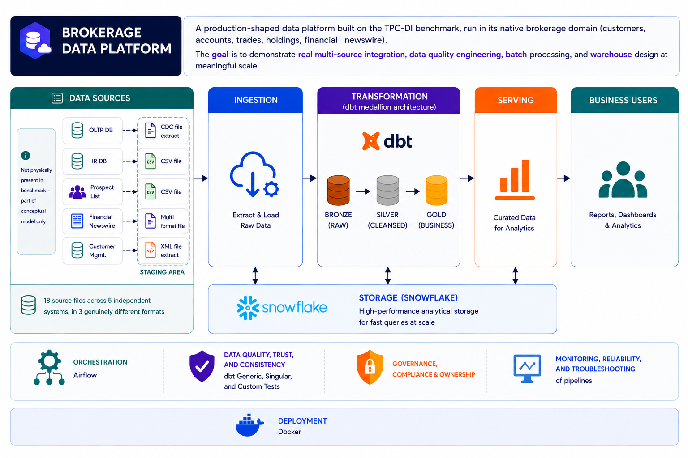

# Brokerage Data Platform: My Interview Guide

## Table of Contents

1. [The 30-second pitch](#1-the-30-second-pitch)
2. [The 2-minute version](#2-the-2-minute-version)
3. [Why I built this project](#3-why-i-built-this-project)
4. [The big picture: architecture and stages](#4-the-big-picture-architecture-and-stages)
5. [Stage 1: Sources](#5-stage-1-sources)
6. [Stage 2: Bronze design](#6-stage-2-bronze-design)
7. [Stage 3: Ingestion](#7-stage-3-ingestion)
8. [Stage 4: Silver](#8-stage-4-silver)
9. [Stage 5: Gold](#9-stage-5-gold)
10. [Stage 6: Data quality](#10-stage-6-data-quality)
11. [Stage 7: Governance](#11-stage-7-governance)
12. [Stage 8: BI and self-service](#12-stage-8-bi-and-self-service)
13. [Stage 9: Orchestration](#13-stage-9-orchestration)
14. [Idempotency: safe reruns](#14-idempotency-safe-reruns)
15. [Top challenges and how I solved them](#15-top-challenges-and-how-i-solved-them)
16. [Trade-offs I can defend](#16-trade-offs-i-can-defend)
17. [What is not finished (honest answers)](#17-what-is-not-finished-honest-answers)
18. [Likely interview questions and my answers](#18-likely-interview-questions-and-my-answers)
19. [Numbers cheat sheet](#19-numbers-cheat-sheet)
20. [Simple word list](#20-simple-word-list)

## 1. The 30-second pitch

- A batch data platform with 23 sources, 3 formats (CSV, XML, fixed-width) to data warehouse in Snowflake.
- I focused on data quality, governance, and idempotency.
  -  two systems describe the same customer in two different ways.
  -  re-runs must not create duplicates.

## 2. The 2-minute version

"The project is based on **TPC-DI**. It is an industry benchmark that is built to copy real data integration problems. It has 5 independent systems: a trading system, an HR system, a prospect vendor, a financial newswire, and a customer management system. They send CSV, XML, and fixed-width files.

I used the **medallion architecture**: bronze, silver, and gold.
- bronze, silver, gold layers.
- data quality layer
- governance layer (roles, PII masking, classification, retention)
- Power BI model
- Airflow DAG that runs one batch per day.

## 3. Why I built this project

- Most portfolio projects use a clean public dataset. That shows you can write dbt models. It does not show you can make decisions when data is wrong or confusing.
- TPC-DI gives me real problems: schema changes between batches, CDC columns that are not real CDC, and XML + flat files for the same entity.
- I wanted a project that looks like a real company pipeline: batches, reruns, audit files, access control, and downstream users.

## 4. The big picture: architecture and stages

## 5. Stage 1: Sources 

- **23 sources** = 21 TPC-DI data files + 2 control feeds (`BatchDate.txt` and `*_audit.csv`).
- Formats: pipe-delimited, comma-delimited, nested XML, and fixed-width text.
- **Batches:**
  - Batch 1 = the historical load.
  - Batch 2 and 3 = incremental loads.
- Important facts I found when I checked the real files:
  - Some files have **different column counts** in Batch 1 and Batch 2/3.
  - Some "CDC" files are **not real CDC**.

## 6. Stage 2: Bronze design

- 1:1 but add metadata columns.
  - `_batch_id` — which batch loaded this row
  - `_source_file` — which file it came from
  - `_loaded_at` — when it was loaded
  - `_row_hash` — a hash of the business columns (for QA and dedup)
  - `_dq_errors` — a JSON list of cast errors, or NULL if clean

### The five archetypes

I looked at all 23 sources and saw that they are not all the same. If I used one loader pattern for everything, the design would fail. So I grouped them into 5 archetypes:

| Archetype | Sources | What is special |
|---|---|---|
| **A. Static reference** | HR, Date, Time, StatusType, TaxRate, Industry, TradeType | Loaded once, never changes |
| **B. Schema-shifting CDC** | Account, Customer, Trade, HoldingHistory, WatchHistory, DailyMarket (and CashTransaction) | Column count changes between Batch 1 and Batch 2/3 |
| **C. Snapshot dimension** | Prospect | Full re-extract every batch, no CDC |
| **D. Non-tabular** | CustomerMgmt.xml, FINWIRE | Need parsing before they are even rows |
| **E. Batch-1-only fact** | TradeHistory | Loaded once, but it is fact data |

## 7. Stage 3: Ingestion 

### Loaders

| Loader | Handles |
|---|---|
| `delimited_loader` | 15+ pipe/comma sources, driven by a config file |
| `finwire_loader` | Fixed-width file with 3 record types (CMP, SEC, FIN) |
| `xml_loader` | Nested XML, flattened into two tables |
| `audit_loader` | Audit files and `BatchDate.txt` |

### Problem 1: Schema shift between batches

**Problem:** Trade, HoldingHistory, WatchHistory, and DailyMarket have different column counts in Batch 1 and Batch 2/3.

**Bad solution:** Write "Batch 1 = no CDC columns" in the code. This breaks if the shift happens in a different batch.

**My solution:** The function `_split_cdc()` counts the fields on **each line**:
- field count = base columns → no CDC columns, so I add `('I', 0)`.
- field count = base + 2 → CDC columns exist, use them.
- anything else → raise `ValueError` and stop.

**Why it is good:** The code follows the real shape of the file, not the batch number. And if something is unexpected, it stops loudly instead of silently misaligning columns.

### Problem 2: Bad values (right shape, wrong content)

**Problem:** A field like a date can be corrupt (for example `1933k-04-19`).

**My solution:** `_safe_cast()` never crashes the batch. It returns `NULL` for the value **and** a structured error: `{column, raw_value, error_type, error_msg}`. All errors for a row are packed into the `_dq_errors` column.

**Why:** One bad date should not stop a whole batch. But I also should not lose the evidence. Bronze loads everything and keeps the proof. Silver decides what to do with dirty rows.

### Problem 3: Big files and memory

I compared three options:

1. **Load the whole file in memory (DataFrame)** — rejected. Memory grows with file size, and big files like FINWIRE and the XML can crash the process.
2. **Insert row by row** — rejected. Too slow, and it does not fit Snowflake bulk loading.
3. **Stream + chunked staging** — **accepted.** I read the file as a stream, keep 5,000 rows in memory, write them to a local CSV, then `PUT` + `COPY INTO`.

Result: **constant memory use** no matter how big the file is. For XML I use `ET.iterparse` and clear each `Action` after processing.

### Problem 4: Polymorphic fixed-width file (FINWIRE)

Each line starts with a timestamp and a 3-letter record type. The type tells me how to cut the rest of the line. One field, `CoNameOrCIK`, can be a company name or a CIK number. I resolve it while parsing: only digits means CIK, otherwise it is a name. An unknown record type raises an error immediately.

### Problem 5: Nested XML

`CustomerMgmt.xml` has `Action` > `Customer` > `Account`. I flatten it into two tables: customer and account. Update actions can be **sparse** (for example, `C_TIER` is missing on an `UPDCUST`). I do **not** fill those gaps in ingestion. That is a silver decision.

### Explicit column list in `COPY INTO`

- explicit column list, never position only. 
- This stops the loader and the table from silently drifting apart. 
- `ON_ERROR = 'ABORT_STATEMENT'`, so no partial load.

### FINWIRE carries 3 different record types in one file.

- security
- company
- financials

handled it row by row, and split the data into 3 tables.

## 8. Stage 4: Silver

### Two dedup shapes, one macro (ADR-003)

All dedup goes through one macro: `dedup_latest`. There are two different logics:

- **State-tracking dedup:** one row per key, latest wins. Used for static dimensions, Prospect, and `silver_trade`.
- **Append-only dedup:** only remove exact duplicate rows. Every distinct event stays. Used for quasi-CDC logs, SCD2 models, and `silver_trade_history`.

### ADR-001: Account and Customer (my biggest silver decision)

**Problem:** The same business entity comes from two sources:
- Flat-file CDC (`Account.txt`, `Customer.txt`) — has a real status column and a real I/U flag.
- XML (`CustomerMgmt.xml`) — has no status column, only an `ActionType` with 6 values.

Two vocabularies, two trust levels (source-provided vs. derived).

**What I decided:**

1. **Unify both sources** into one SCD2 model.
2. **Map XML action types to I/U.** For example Account: `NEW→I`, `ADDACCT/CLOSEACCT/UPDACCT→U`.
3. **Derive status for XML** using the same domain as the flat file: `NEW/ADDACCT→ACTV`, `CLOSEACCT→INAC`, and `UPDACCT/UPDCUST→NULL` then forward-fill. Why: the update actions carry no status signal at all (I checked), so they must inherit the previous value.
4. **Filter the XML customer events.** A real query showed six action types. Only `NEW`, `UPDCUST`, and `INACT` are customer events. `INACT` has no attributes, but it is a real state signal ("customer became inactive"), so I keep it.
5. **Grain = one row per entity per day.** I keep the last event of the day, and only if a **tracked column** changed.
6. **Tracked vs carried-only columns.** Only tracked columns (status, name, tier, address, email, etc.) create a new version. Phone numbers and similar fields are carried but do not create history. This was a business decision.
7. **Ordering key:** `_batch_id, action_ts, _cdc_dsn, _loaded_at`. Why: the XML historical batch has the same `_batch_id` and `_cdc_dsn = 0` for many events of the same entity. Without `action_ts` they would tie and the order would be undefined.

### The forward-fill bug (good story to tell)

**Problem:** Partial updates (like `UPDACCT`) have NULLs. I use `LAST_VALUE(...) IGNORE NULLS` to fill them.

**Bug I found:** At first I collapsed events to one row per day **before** forward-filling. This was wrong: an early event's value could be lost, and the kept row ended up with NULL.

**Fix:** Forward-fill over **every individual event** in full time order first. Then collapse to the last row of the day.

### ADR-002: Trade split (the fan trap story, very important)

**Problem:** `bronze_trade` (Batch 2/3) arrives as one event per status change, so there are many rows per `trade_id`. If I build a fact table on that shape, then `SUM(commission)` is multiplied by the number of status changes. This is the classic Kimball **fan trap**.

**My solution:** split Trade into two models:

- `silver_trade` — **one row per trade**, latest known economic state.
- `silver_trade_history` — **one row per (trade, status timestamp, status)**, the full status journey.

**A detail I am proud of:** For `silver_trade_history`, I union `bronze_trade_history` (Batch 1 full lifecycle) with `bronze_trade` filtered to Batch 2/3 and to real status transitions only. I **exclude** Batch 1 rows from `bronze_trade`. Why? A real query showed `TRADE_ID` is unique in Batch 1, which means that table only has each trade's **final** status. Adding it would duplicate or conflict with the full lifecycle I already have. I also add a `_source_model` column to show where each row came from, instead of using `_batch_id = 1` as a hidden trick.

### ADR-005: Incremental append for quasi-CDC

**The quasi-CDC finding:** HoldingHistory, WatchHistory, DailyMarket, and CashTransaction look like CDC, but `CDC_FLAG` is always `'I'` and rows are never updated. They are really **insert-only event logs** with CDC-looking column names. I call this **quasi-CDC**.

**Decision:**
- Bronze keeps the columns as they are (1:1 rule).
- Silver treats them as append-only logs.
- They are `incremental` + `append`, filtered on `_loaded_at > max(_loaded_at)`, with `on_schema_change='fail'` and no `unique_key`.

### Other silver strategies 

- Static dimensions: pass-through + defensive dedup.
- Prospect: SCD1, one row per `agency_id`, latest batch wins.
- FINWIRE: append-only by timestamp.
- XML tables: not modeled alone. They are folded into account/customer.

## 9. Stage 5: Gold

### The model

A Kimball star schema with **17 tables**:
- **10 dimensions:** date, time, statustype, tradetype, broker, company, security, customer, account, prospect. Two are SCD2 (`dim_account`, `dim_customer`).
- **7 facts:** trade, trade_history, holding, cashtransaction, watchitem, market_history, company_financials.

### Key ADRs

**ADR-009 — Trade fact split.** Same idea as silver: `fact_trade` (latest state, one row per trade) and `fact_trade_history` (status lineage). They connect by a real FK, which is safe because it is a true one-parent-to-many-children relationship.

**ADR-005/006 — Derived FKs on `fact_holding`.**
- Problem: HoldingHistory only has trade IDs and quantities. It has no account, security, or date.
- Solution: during ETL I look up the trade in `fact_trade` and store `account_sk`, `security_sk`, and `holding_date_sk` directly on `fact_holding`.
- Rejected: a live fact-to-fact join (risky and hard for BI tools), and no FK at all (makes every query hard).
- I also found the relationship is **not 1:1**. One original trade can have many holding rows, and one sell trade can close several lots. So I keep both trade IDs as plain **degenerate dimensions** and I document that they are "lineage, not a guaranteed join."
- Cost: `fact_holding` must load after `fact_trade`.

**ADR-001 — Outriggers, not centipede facts.** Company and prospect are reached through one controlled hop from their parent dimension. I rejected adding company and prospect keys to every fact (two join paths, risk of double counting) and full snowflaking (too many joins for little value).

**ADR-002/003 — Denormalize Industry and Tax Rate.** These are small, low-cardinality tables. A separate dimension would add a join with no benefit. So I flatten them into `dim_company` and `dim_customer`.

**ADR-007 — Surrogate keys, with two exceptions.**
- `dim_date` and `dim_time` use the smart integer key from the source (easy filters like `date_sk BETWEEN 20260101 AND 20260131`, easy partitioning).
- `fact_trade.trade_sk` uses `trade_id` directly, because I checked that it is globally unique. Creating another key would be extra indirection for nothing.

**ADR-004 — `dim_prospect.customer_sk` is nullable.** Most prospects never become customers. A NOT NULL rule would block most of the table.

### Gold presentation controls

- Every dimension has an **Unknown member** row with `_sk = -1`.
- Every fact FK is wrapped in `coalesce(..., -1)`, so no fact FK is ever NULL. NULL keys behave differently in different BI tools.
- Categorical attributes use `'Unknown'` instead of NULL. Free text and IDs stay NULL.
- Accepted trade-off: `-1` cannot tell "no match" from "time-range miss." I documented it and will revisit if it causes a real reporting problem.

## 10. Stage 6: Data quality
> [!Note]
> Read Data Quality page

### Controls by layer

**Bronze**
| Dimension | Control |
|---|---|
| Validity (shape) | Field-count check in `_split_cdc()`, unknown FINWIRE record type raises |
| Validity (content) | `_safe_cast` → NULL + `_dq_errors` |
| Integrity | `BatchDate.txt` raises on a bad date (the only hard-fail cast) |
| Consistency | `COPY INTO` with explicit column list |
| Uniqueness | Batch idempotency check |
| Completeness | `BatchDate.txt` is required |
| Accuracy | Reconcile row counts against the vendor `*_audit.csv` |
| Timeliness | dbt source freshness, 24-hour warning, only on incremental tables |

**Silver**
- dbt tests: `not_null`, `unique`, `unique_combination_of_columns`, `accepted_values`, `relationships`.
- Errors on key/uniqueness tests. Warnings on `accepted_values` and `relationships` (so late-arriving data does not break the build).
- SCD2 tests: one current row per entity, no overlapping date ranges, no gaps between versions, no NULL regression after forward-fill.
- Business-rule tests: valid trade status order, and no false versioning (a new SCD2 version only when a **tracked** column changed).

**Gold**
- Unknown-member rows, FK integrity tests (warn), unique + not-null on surrogate keys, and a grain test per fact.

### Reconciliation framework

One shared macro, `log_reconciliation()`, with two wrappers: bronze→silver (per batch) and silver→gold (total count). Results go to `governance.dq_audit_log`.

- Thresholds are **per model**, because the expected change is very different. For example: `silver_hr` 1%, quasi-CDC logs 2%, `silver_trade_history` 30%, `silver_customer` 50%, and `silver_trade` 80% (because collapsing is the whole point of that model).
- Results are `PASS` or `WARNING`. **Never fatal**, because a difference may be expected (dedup, collapse, filter).
- I log **passes too**, not only failures. This proves coverage.
- Honest note: thresholds are starting defaults, not business SLAs.

### Test result logging (ADR-6.4.5)

I wrote a custom macro `log_test_results()` plus dbt's native `store_failures`, instead of using the Elementary package. Reason: all other evidence already lives in the `governance` schema, and I do not need alerting or anomaly detection yet. I wrote down when I would change this decision (when the team needs alerts or a dashboard).

